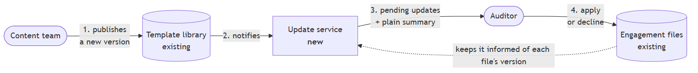
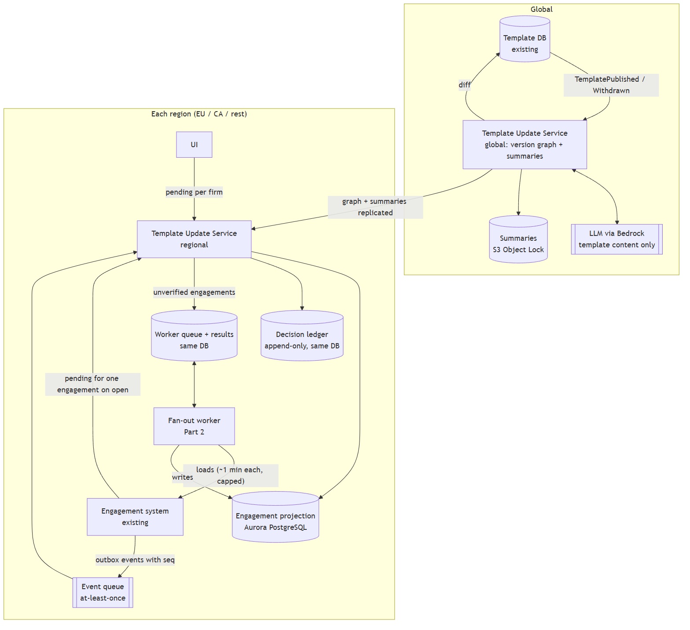
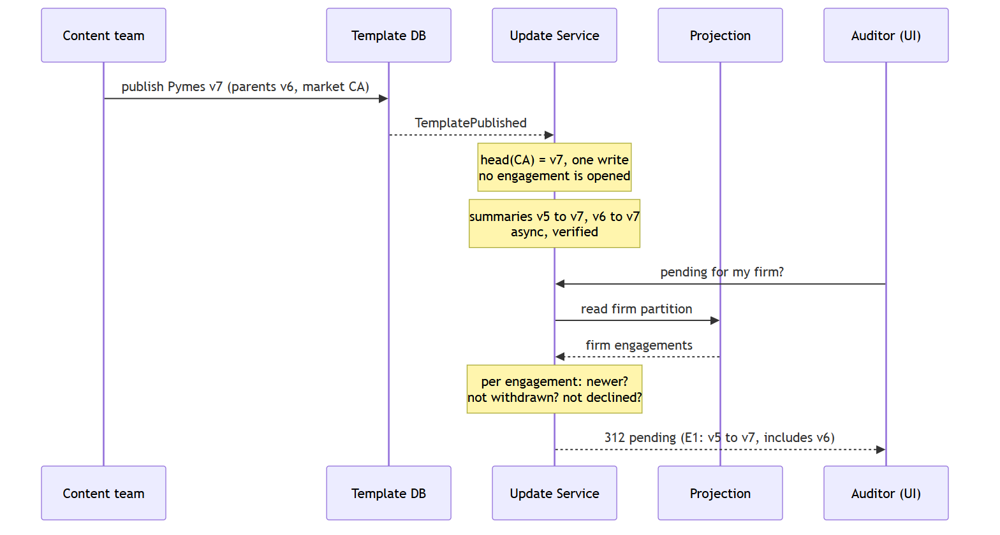
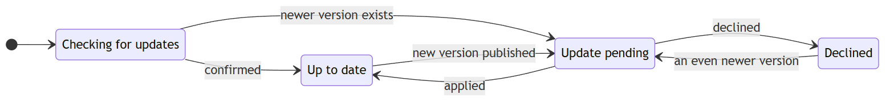
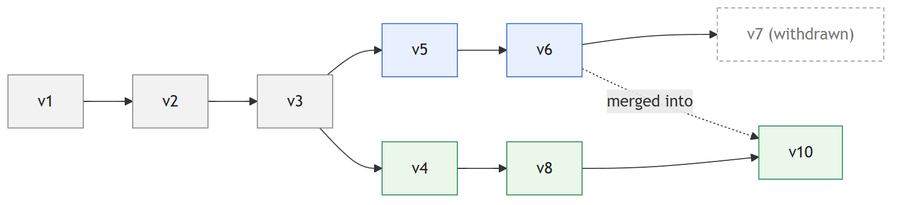
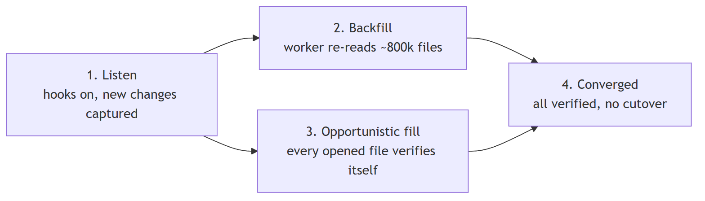

# Pending Template Updates — Design

> **In one minute**
> - Seconds after a publication, auditors see which files have an update waiting, with a plain summary; each decision is kept as audit evidence.
> - We never open files to find out (a minute each, 800,000 files): a small list of each file's version, fed by events, makes a publication cost the same for 10 files or 100,000.
> - Main dependency: the engagement team must emit those events. Main cost: a one-off check of all files; AI stays under $30 a month.

**Core decision.** Never load an engagement to publish or to read. Keep a regional, rebuildable **projection** (each engagement's version and declines), fed by events, and compute "pending" on read against a global **version graph**.

## 1. Architecture and data ownership





| Data | Owner | Where | Notes |
|---|---|---|---|
| Template content and versions | Template DB (existing) | Global | Source of truth |
| Engagement content; executing apply/decline | Engagement system (existing) | Per region | Source of truth, plus hooks |
| **Projection**: engagement, firm, market, version, declined frontier, `seq`, verified | Update Service (new) | Per region, Aurora PostgreSQL | Rebuildable, never a source of truth |
| **Version graph**: versions, parents, market, withdrawn | Update Service | Global, read-only regional copies | ~2,000 versions/year: in memory |
| **Summaries** per (template, from, to, language) | Update Service | Global, copied to regions | No firm data |
| **Decision ledger**: who, what, when, summary shown | Update Service | Per region, append-only | `UPDATE`/`DELETE` revoked |

**Event hooks** (the brief allows them on both systems): `TemplatePublished(id, version, parents, market)` and `TemplateWithdrawn` on the template side; `EngagementCreated`, `EngagementOpened`, `UpdateDecided`, `UpdateApplied`, `UpdateApplyFailed` on the engagement side, each with a **per-engagement sequence number (`seq`)** to detect lost or out-of-order events, sent through a **transactional outbox** so no saved change goes unannounced.

**What we need from the engagement team** (to agree before building)

| Ask | If not available |
|---|---|
| Events through an outbox, with `seq` | Reconciliation only: slower, more drift |
| `EngagementOpened` with version, market and declines; query us on open | Worker-only backfill (~11 days); indicator only in our UI |
| List engagements without loading them | Read their databases' metadata |
| A negotiated cap on concurrent loads, higher at night | Same design, longer backfill |

**Pending rule** (on read). Engagement *E* on version *b* in market *m* is offered `head(m)`, the newest non-withdrawn version of *m*'s branch, if `head(m)` contains *b* and is not contained in any version *E* declined.



**Data residency.** Firm data never leaves its region (EU, Canada, rest); template data flows global → regional, and the LLM sees template content only. **Tenant isolation:** the firm comes from the authenticated token, every table carries `firm_id` under PostgreSQL row-level security, and tests prove cross-firm reads fail.

## 2. Correctness and production evolution



An **unverified** file shows **"checking for updates", never "up to date"** (see risks).

**Version semantics.** Versions form a DAG: each market follows its branch, merges are allowed, and "older" means "ancestor of".


*Grey: shared · blue: Canada · green: EU · dashed: withdrawn.*

- **Accumulation:** several versions collapse into one update `base → head`, summarised from the **direct diff** (net change only).
- **What a decline pins:** templates apply whole, so declining *v* pins a **frontier**: *v* and all its ancestors are never offered again. A later version containing *v* is offered, its summary split into "already declined on 14 Mar" and "new since then". A file on v5 that declined v7 is offered nothing until a newer Canada version exists.
- **Withdrawal:** the head is recomputed (one write); files already on it are flagged, not reverted; nothing declined resurfaces (v6 is still not offered).
- **Races:** a decision applies to the version whose summary the user saw.

**Unreliable event delivery**

| Failure | Handling |
|---|---|
| Source saves, then crashes before emitting | Transactional outbox in the source |
| Lost or duplicated in transit | At-least-once queue (SQS); handlers idempotent on `(engagement, seq)` |
| Gap detected (seq 5 → 7) | Set to unverified; re-read by the fan-out worker |
| Lost publication | Heads reconciled with the Template DB every 5 min |
| Silent drift | Daily re-read of a random 0.1 % (~800 files), tracked as an SLO |

**Migration and backfill, no maintenance window**



Hooks go on first, so nothing new is missed. The fan-out worker (Part 2) then loads the ~800k existing files, reading the *current* version, market and past declines (the creation version is not enough), while each `EngagementOpened` verifies a file for free. Each file turns verified on its own: no cutover. **Race guard:** a backfill write carries the `seq` read at load time and is accepted only if newer (`UPDATE … WHERE seq < :seq`), so a slow read never overwrites a newer event.

**Failure recovery.** The projection is rebuilt from events plus re-reads; the worker resumes without repeating work.

## 3. Scale, cost and operations

**Why not load the files on each publication:**

```
40 products × 1 publish/week × ~20,000 engagements = 800,000 loads/week
800,000 load-minutes ÷ 10,080 minutes/week ≈ 80 concurrent loads, 24/7, forever
```

That exceeds a capacity-limited system on day one. With the projection, a publish is O(1) writes.

**Read path.** 10 % of files viewed in the peak hour: 80,000 ÷ 3,600 s ≈ **22 requests/s** of indexed, paginated queries per firm: trivial for PostgreSQL.

**Backfill (one-off).** 800,000 loads × 1 min ÷ 50 concurrent = 16,000 min ≈ **11 days**; 100 concurrent ≈ 5.6 days; 50 by day and 200 by night ≈ 5 days. The opportunistic fill shortens it. **Recurring loads:** sampling (~800/day) plus gap repairs ≈ 25,000/month ≈ 0.6 concurrent on average.

```
summaries ≈ 3 versions in use × 40 publishes/week ≈ 500/month
tokens    ≈ 500 × (20k in + 2k out) = 10M in + 1M out per month
Haiku     ($0.10 / $0.50 per M) ≈ $1.50/month; all on Sonnet ($2 / $10) ≈ $30/month
monthly   ≈ F_infra (3 regions) + 25,000 · c_load + ≤ $30 inference
one-off   ≈ 800,000 · c_load
```

Recurring cost is fixed infrastructure (low hundreds of dollars), not AI; storage is ~400 MB. The material cost is the backfill, priced by the engagement team's cost per load (`c_load`). $X is unknown, so cost is a formula; Bedrock prices must be confirmed.

**SLOs:** publish → pending visible p95 < 30 s; firm pending list p95 < 300 ms per page, 99.9 % monthly availability; summary available p95 < 5 min (the indicator does not wait for it); projection accuracy < 0.1 % sampled mismatches.

**Fan-out worker (Part 2):** one active dispatcher per region (PostgreSQL advisory lock), so the negotiated cap is exact. Details in `fanout-worker/README.md`. **Alerts:** event lag, `seq` gaps, unverified count not falling, downstream "overloaded" answers, retry-budget use, summary fallback > 5 %, any summary hash mismatch.

## 4. Change summaries: generation and evaluation

Once per (template, from, to, language), at publish time, for versions in use:

1. Take the JSON diff from the existing comparison tool.
2. **Always** produce a rule-based summary from the template's own titles (*"Adds procedure 'Physical inventory count' to section 'Assets'"*): exact, but long for big changes.
3. Ask Claude Haiku (escalating to Sonnet) for a shorter plain-language version as **structured output**: section, change type, text and the **diff paths each item is based on**.
4. **Verifier gate on every AI summary:** each item cites an existing diff path (nothing invented) and every diff path is covered (nothing omitted). On failure, timeout or no model, the rule-based summary is shown: the service never depends on the AI.

**Evaluation:** a human-reviewed golden set re-runs on every prompt or model change, the content team reviews a monthly sample, and the fallback rate is tracked. The AI says *what* changed, never its audit impact.

**Defensibility** (a summary shown in March, questioned in November):

Summaries are never regenerated in place: S3 Object Lock (compliance mode) keeps them 7 years with the diff snapshot, hashes, model and prompt versions, raw output and verification result. Each ledger entry stores **the summary ID the user had on screen**; an improved summary is a new version. Firms can export a file's evidence pack in-region.

## 5. Tradeoffs, assumptions, challenge, risk, omissions

| Chosen | Over | Because | Cost accepted |
|---|---|---|---|
| Projection fed by events | Loading engagements | 1 min per load makes loading infeasible | Something new that can drift (see risk) |
| Pending computed on read | Per-engagement flags | O(1) publish, withdrawal and branching | Graph check per read (in memory) |
| Offer only the head, as a net diff | A decision per version | Less noise; shows what will really change | No cherry-picking of intermediate versions |
| Decline pins a frontier | One version, or the whole file | Templates apply whole; safe under withdrawal | Declined changes may reappear, clearly labelled |
| Aurora PostgreSQL per region | DynamoDB | Relational access (paginated lists, counts, a work queue) on small data | A database to operate |
**Assumptions:** the engagement system can emit events and list files without loading them; a load shows version and declines; publish events carry parents and market; the cap of 50 is per region.

**Requirement we would challenge: deciding file by file.** A 40,000-file firm would review the same change thousands of times. We propose **cohort decisions**: one decision for all of a firm's files sharing (template, market, current version), recorded per file, with overrides. Real-time indicators are cheap; *applying* at that scale is not.

**Riskiest part: projection drift producing a false "up to date".** An auditor would miss a regulatory change. Mitigations: the unverified state, `seq` gaps, outboxes, head reconciliation and the accuracy SLO. Only an audited operator role can raise the cap or start a backfill.

**Left out:** applying content, UI, notifications, undoing decisions, market changes, archived files, bulk-apply capacity.
